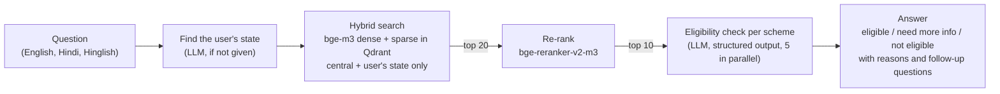

# Scheme Eligibility Assistant

Tells Indian citizens which government schemes they qualify for. A person describes their
situation in their own words, in English, Hindi or Hinglish. The assistant finds the
relevant schemes among 4,688 central and state schemes and checks each one against that
scheme's eligibility rules.

Every design choice below was measured on held-out test sets before it was kept.

## Example

```
$ uv run scheme-assistant "I am a 58-year-old widow living in Leh. I have no income and a BPL card."

State: Ladakh

Eligible
  - Indira Gandhi National Widow Pension Scheme (ignwps)
    The applicant is a 58-year-old widow, which falls within the required age bracket of
    40-79 years, and belongs to a below-poverty-line (BPL) household.
  - Integrated Social Security Scheme: Pension for Women in Distress (issspwd)
  ...

Need more information
  - Indira Gandhi National Disability Pension Scheme (igndps)
    The applicant meets the age and BPL criteria, but has not specified whether they have
    a physical or mental disability with a disability level exceeding 80% or are a dwarf.
    ? Do you have a physical or mental disability, and if so, is your disability more than 80%?
  ...

Not eligible
  - NSAP - Indira Gandhi National Old Age Pension Scheme (nsap-ignoaps)
    You must be at least 60 years of age to be eligible for this scheme, but you are
    currently 58 years old.
```

(Output shortened. The full answer listed 4 eligible schemes, 5 needing more information and 1 not eligible.)

## How it works



1. **State.** If the user's state is not given, an LLM reads it from the question ("Leh"
   becomes Ladakh).
2. **Search.** The question is embedded with bge-m3 (multilingual). Dense and sparse
   results are merged with weighted Reciprocal Rank Fusion (70/30). Only central schemes
   and the user's state's schemes are searched.
3. **Re-rank.** A cross-encoder reads the question with each of the top 20 schemes and
   re-orders them.
4. **Eligibility check.** For each of the top 10, an LLM compares the person's description
   with the scheme's own eligibility text. It returns a verdict, a reason and the missing
   facts, validated with Pydantic.
5. **Answer.** Eligible schemes are listed first.

The LLM layer is provider-neutral: any Gemini, Gemma or Claude model can be used with
`--model <name>`, and every call's tokens and cost are recorded.

## Results

All numbers are on held-out **test** sets: 40 search queries and 66 eligibility cases,
including boundary, indirect, Hinglish and multi-condition cases. Settings were chosen on
separate dev sets. Full tables, per-case results and set construction are in
[`data/eval/README.md`](data/eval/README.md).

### Search: is the right scheme found?

| Setup | Hit@1 | Hit@10 | MRR |
|---|---|---|---|
| Dense only | 0.55 | 0.82 | 0.64 |
| Hybrid 70/30 | 0.57 | 0.85 | 0.66 |
| Hybrid 70/30 + state filter | 0.75 | 0.93 | 0.80 |
| **+ re-rank top 20** (current) | **0.82** | **0.95** | **0.86** |

### Eligibility check: is the verdict right?

Given the correct scheme, each model decides eligible, not eligible or need more info.
"False eligible" means telling someone they qualify when they do not, the most harmful
error.

| Model | Accuracy | False eligible | Cost per check |
|---|---|---|---|
| Claude Opus 5.5 | **0.98** | 1 | $0.0071 |
| Gemini 3.8 Flash (default) | **0.98** | 1 | $0.0012 |
| Claude Haiku 5.5 | 0.94 | **0** | **$0.0002** |
| Claude Sonnet 5.5 | 0.92 | 1 | $0.0034 |
| Gemma 4 26B (open) | 0.92 | 3 | free tier |
| Gemini 3.5 Flash-Lite | 0.89 | 2 | $0.0003 |
| Gemma 4 31B (open) | 0.82 | 2 | free tier |

### End to end: does the user get the right answer?

A case succeeds when the right scheme is shown with the right verdict, or, for
`not_eligible`, is not shown as eligible.

| Model | Re-rank | Success | Scheme found | Verdict right when found | Time per question | Cost per question |
|---|---|---|---|---|---|---|
| Gemini 3.8 Flash | yes | **0.94** | 0.92 | 0.98 | 19.5 s | $0.020 |
| Gemini 3.8 Flash | no | **0.94** | 0.94 | 0.98 | 15.2 s | ≈ $0.012 |
| Claude Haiku 5.5 | no | **0.94** | 0.94 | 0.98 | 8.0 s | $0.003 |
| Claude Opus 5.5 | no | **0.94** | 0.94 | 0.98 | 12.0 s | $0.096 |
| Claude Sonnet 5.5 | no | 0.88 | 0.94 | 0.92 | 8.2 s | $0.039 |

### What the evaluations showed

- **The state filter is the biggest single win in search.** It raised test Hit@1 from 0.57
  to 0.75.
- **LLM query rewriting did not help search.** bge-m3 already handles Hindi and Hinglish,
  and translation lost details. Search uses the original question, and the LLM is only
  used to find the state.
- **Strong models get the verdict right 98% of the time.** Haiku is the best value: 1/30
  of Opus's cost and no false "eligible" verdicts.
- **Search is now the bottleneck.** Most end-to-end failures are schemes that were never
  retrieved, usually because the question was vague ("I want a loan to start a business").
- **Re-ranking clearly improves search order** (Hit@1 +7 points). End to end, it gained
  4 points on dev for both Flash and Haiku and tied on test with Flash. Order matters less
  when all of the top 10 are checked.
- **Results vary between runs by a few points**, so small differences between models are
  within noise.

## Run it

Requires Python 3.12 and [uv](https://docs.astral.sh/uv/). The models run locally; Apple
Silicon (MPS) and CUDA are used when available.

```bash
uv sync

# API keys, in a .env file at the project root (never committed)
echo "GEMINI_API_KEY=..." >> .env
echo "ANTHROPIC_API_KEY=..." >> .env     # only needed for Claude models

# Data: download the dataset, clean it into data/schemes/, build the search index
uv run python -m scheme_assistant.hf_dataset
uv run python -m scheme_assistant.build_schemes
uv run python -m scheme_assistant.search --build

# Ask a question
uv run scheme-assistant "Main 58 saal ki vidhwa hoon, Leh mein rehti hoon" --model claude-haiku-5-5
uv run scheme-assistant "I farm 2 acres" --state Bihar --no-rerank
```

### Tests and evaluations

```bash
uv run pytest                     # unit tests (no API calls, no model downloads)
uv run ruff check src tests

uv run python -m scheme_assistant.evaluate --split test                          # search
uv run python -m scheme_assistant.evaluate_rewrite --split test                  # query rewrite
uv run python -m scheme_assistant.evaluate_eligibility --split test --model <m>  # eligibility
uv run python -m scheme_assistant.evaluate_pipeline --split test --model <m>     # end to end
```

Evaluation runs write their results to `data/eval/results/`.

## Project structure

```
src/scheme_assistant/
  hf_dataset.py, build_schemes.py   download and clean the scheme data
  models.py                         Pydantic models for schemes and evaluation data
  search.py                         bge-m3 embeddings, Qdrant index, hybrid search, state filter
  rerank.py                         cross-encoder re-ranking
  llm.py                            provider-neutral LLM client (Gemini, Gemma, Claude) with cost tracking
  rewrite.py                        reads the user's state from the question
  eligibility.py                    per-scheme eligibility check
  assistant.py                      the end-to-end assistant
  evaluate*.py                      search, rewrite, eligibility and end-to-end evaluations
tests/                              unit tests with fake embedder, re-ranker and LLM
data/eval/                          labelled dev/test sets, results and their write-up
```

## Tech stack

Python 3.12, uv, Pydantic · bge-m3 and bge-reranker-v2-m3 (FlagEmbedding) · Qdrant ·
Gemini API (Gemini, Gemma) and Anthropic API (Claude) with structured output · pytest, ruff

## Limitations

- **Small evaluation sets.** One search query is 2.5 points and one eligibility case is
  1.5 points.
- **Synthetic test data.** Queries and cases were written by an LLM from the scheme text
  and have not been reviewed by hand or tested with real users.
- **Dataset text only.** The rules come from the dataset text, which may differ from the
  official rules. The assistant is a guide, not an official decision.
- **Vague questions.** These are the main source of errors.

## Roadmap

- [x] Hybrid search with state filter, query rewrite study, re-ranking
- [x] LLM eligibility check with a 7-model comparison and end-to-end evaluation
- [ ] Agent that asks follow-up questions for vague or incomplete descriptions
- [ ] Faithfulness check on the reasons the model gives
- [ ] API and web interface
- [ ] Tracing and monitoring of LLM calls
- [ ] Docker, CI and a public deployment
- [ ] Fine-tune a small open model for the eligibility check

## Data

Scheme data comes from the Hugging Face dataset
[`smartduketech/indian-government-schemes-2025`](https://huggingface.co/datasets/smartduketech/indian-government-schemes-2025),
which is sourced from [myScheme](https://www.myscheme.gov.in/). It is downloaded at setup
and not stored in this repository.
